# Pria 5

A compact mono two-way speaker that I designed, 3D printed, measured and tuned at home.
It uses a 3.5 in woofer, a 19 mm tweeter in a printed waveguide, two side-firing passive
radiators and a small DSP amplifier board. The "5" is the fifth design generation.

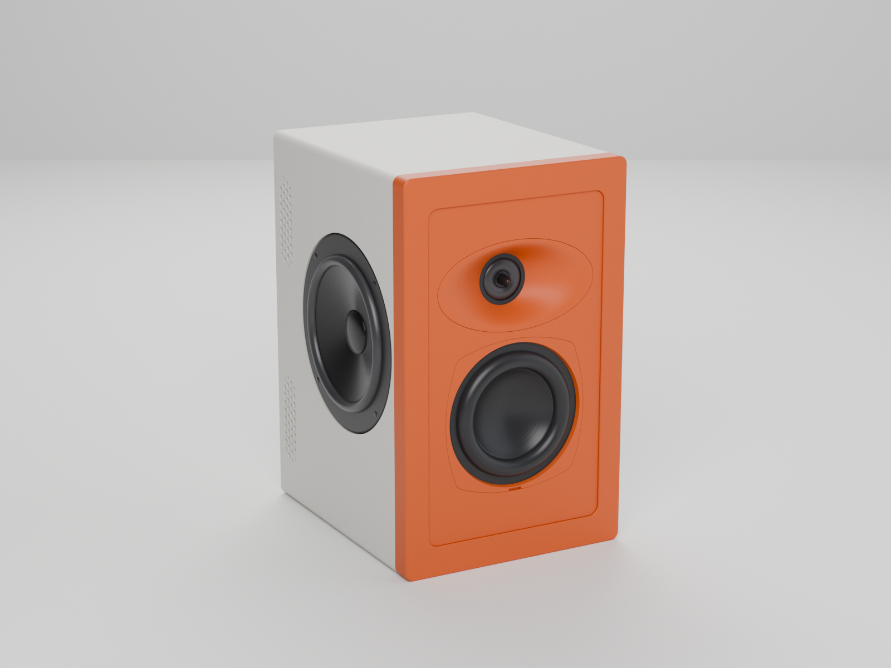

The current mechanical release is **R4.35** (2026-10-20). Getting there took 23 named versions
(V1 to V5.2) and 39 numbered revisions of V5.2 after that. Each one changed because a print
failed, a part didn't fit, a measurement said so, or I changed my mind about how it should look.
This repository has the printable files, the measurements and DSP settings it was tuned with,
and the reasons behind the main changes.

> **Status.** The cabinet body is printed and working. The tuning measurements below were
> made on the first complete prototype (2026-09-29 to 2026-10-02). The waveguide shape and
> driver layout haven't changed since. The newest parts (R4.31 to R4.35: the baffle, the
> magnetic frame, the tweeter retainer and the wire plate) are checked in CAD and the slicer
> and haven't been printed yet. Nothing here has been
> measured in an anechoic space or across a full polar set.

## At a glance

| | |
|---|---|
| Woofer | Dayton Audio ND91-4, 3.5 in aluminium cone |
| Tweeter | Tymphany (Peerless) OT19NC00-04, 19 mm ring radiator, with a 33 µF / 100 V bipolar capacitor in series for protection |
| Bass loading | 2 × Dayton Audio DS115-PR passive radiators, mounted on opposite sides, 11 g added to each |
| Amplifier and DSP | Dayton Audio KABD-250 (ADAU1701), programmed in SigmaStudio, 24 V / 5 A supply |
| Crossover | 3 kHz Linkwitz-Riley 24 dB/oct, tweeter delayed 3 samples (62.5 µs at 48 kHz) |
| Waveguide | Printed elliptical waveguide, 98 × 50 × 16 mm |
| Tuning | About 50 Hz, from nearfield measurements |
| Cabinet | 142 × 230 mm face, about 167 mm deep, PLA, five print plates |
| Input | Bluetooth (stereo summed to mono) |

## How it's built

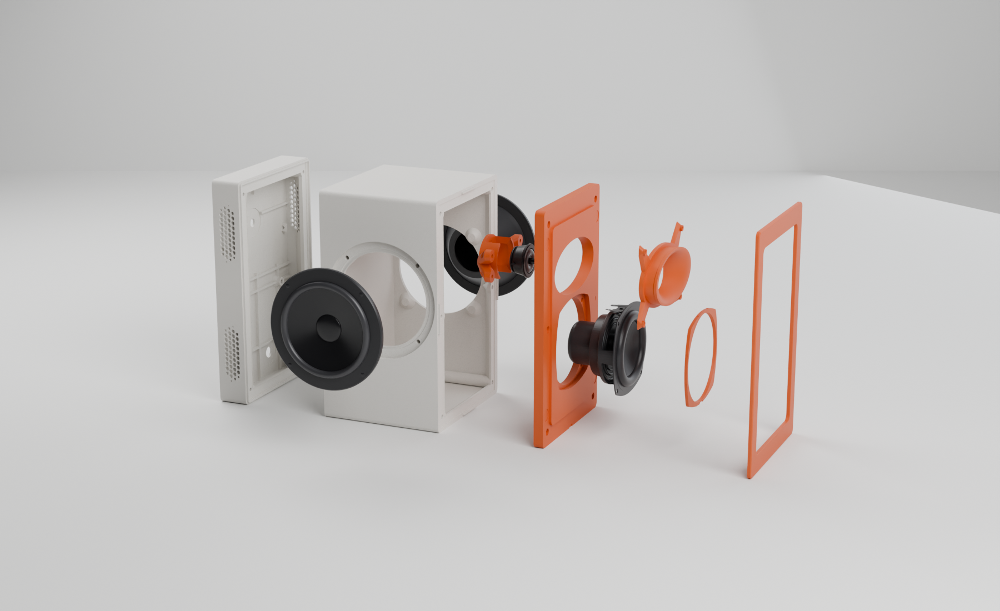

**Cabinet.** Five plates on a Bambu Lab X2D: the front baffle, a magnetic front frame, the body,
the rear, and a plate with the waveguide and the woofer cover. The body holds the
acoustic chamber. The rear holds the amplifier in its own bay, sealed from the chamber by a
bulkhead and a small plate that the speaker wires pass through. The joints are sealed with
1 × 8 mm closed-cell foam tape, and the inside is lined with 1/2 in acoustic foam.

**Front.** No grille. A slim frame covers the six front screws and is held on by four
8 × 2 mm magnets that are sealed inside the print (the printer pauses so they can be dropped in,
then prints over them). The baffle's matching magnets sit in tabbed pockets, settled after three
test coupons.

**Waveguide.** An analytic flare, 98 × 50 × 16 mm, wider than it is tall. It replaced an earlier
borrowed waveguide shape and a series of round ones. Its size was driven by driver spacing: a
smaller guide lets the drivers sit closer (75.6 mm centre to centre), which widens the vertical
range where they add up cleanly. That matters because the speaker sits above ear height.

**Passive radiators.** Two radiators on opposite sides instead of one on the back. Mounted
opposite each other, they push on the cabinet in opposite directions so the forces cancel,
and the pair gave a better low-frequency alignment in the model. Each carries 11 g of added
mass, and the nearfield measurements below show both peaking at the same frequency.

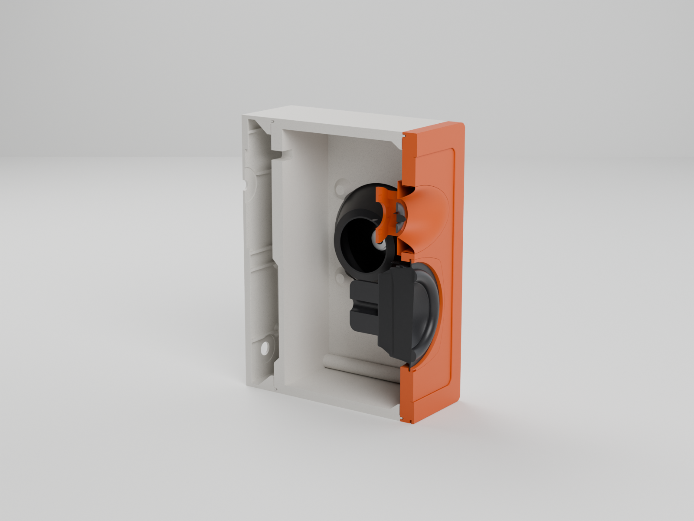

**DSP.** The KABD-250 runs the crossover, EQ and protection:

- 3 kHz LR24 crossover, low branch −4 dB, high branch −10 dB, tweeter delayed 3 samples
- two cascaded 50 Hz high-pass filters (Q 0.71) to protect the woofer
- twelve peaking filters applied the same way to both branches, fitted to a room-averaged
  measurement, plus a 70 Hz boost on the woofer and a 3.5 kHz cut on the tweeter
- a 150 Hz split with a bass-only limiter, a linked peak limiter, and a gentle bass lift at low
  volume

The settings I listen with are written up in [`dsp/`](dsp/), including which values are from
an audited project file and which are later changes I made by ear.

## Measurements

All measurements were taken with a calibrated UMIK-1 and REW, playing over Bluetooth, in a normal
room. They are useful for tuning this speaker in its room. They aren't anechoic data.

**Bass.** Each driver close-miked on its own. The woofer's dip at about 50.5 Hz and both
radiators' peaks at about 49 Hz show the radiators taking over from the woofer around the
tuning frequency. The two radiator curves lying on top of each other was my check that the two
sides behave the same.

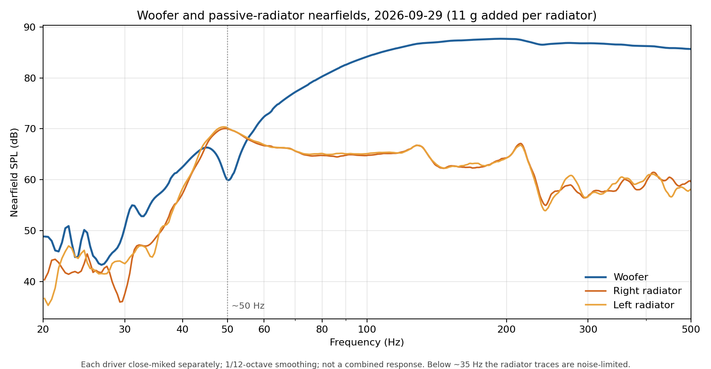

**Tweeter delay.** I tried 2, 3 and 4 samples of tweeter delay and kept 3, which made the dip
near 2.4 kHz above the axis shallower. The dip isn't gone.

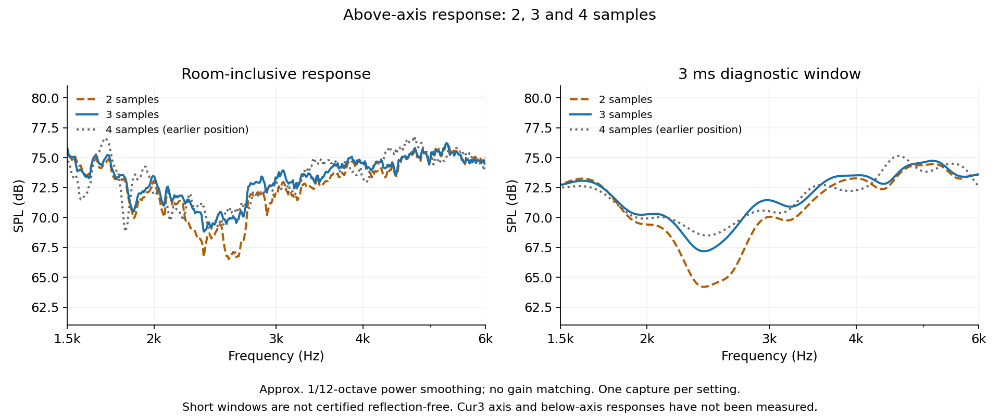

**Off-axis.** At 30° left and right the response follows the on-axis curve closely through the
crossover and falls away gradually above 5 kHz, which is what the waveguide is for.

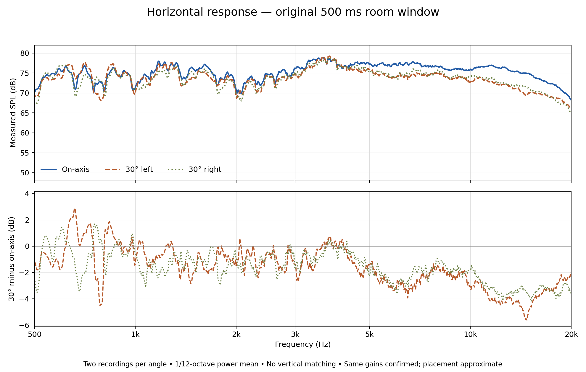

**Room average.** Twelve microphone positions, averaged, against a target that slopes down
gently. After the Tuning12 EQ, 1 to 16 kHz was within −0.82 / +0.89 dB of the target. The full
60 Hz to 16 kHz range was −1.41 / +2.58 dB, so the ±1 dB goal over the whole band wasn't met;
the biggest excess is in the bass, which I chose to keep.

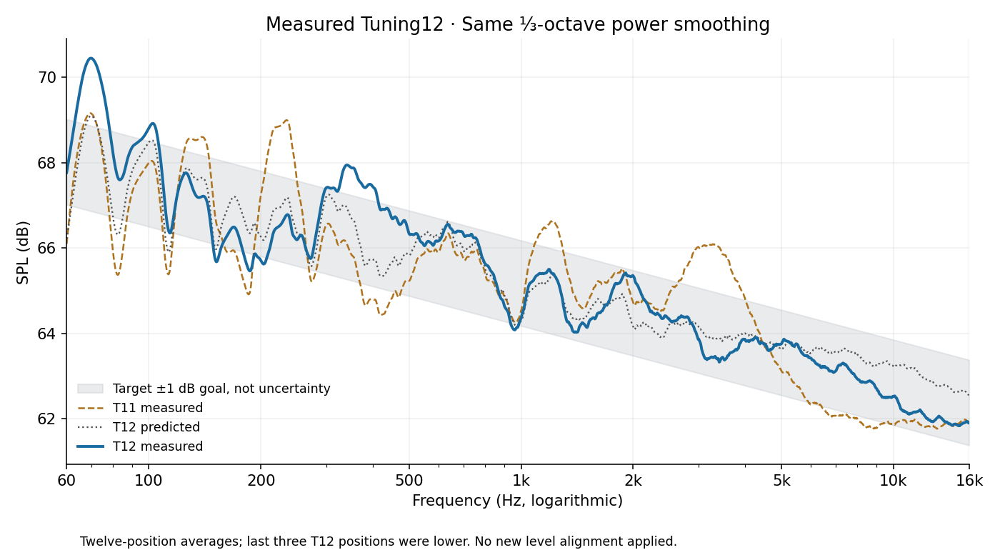

Tuning ran from Tuning01 to Tuning26 over four days, 2026-09-29 to 2026-10-02.
[`measurements/`](measurements/) has the data behind these plots, and
[`docs/design-history.md`](docs/design-history.md) lists what each round changed.

## How it got here

The full timeline is in [`docs/design-history.md`](docs/design-history.md). The decisions that
mattered most:

1. **V5 started over from the acoustics.** V1 to V4.8 were mostly about the enclosure: part
   count, inserts, layout and proportions. V5 began from the drivers and a
   simulated system model, picked the box and waveguide to suit them, and turned the earlier prints into a measurement mule.
2. **V5.2 moved to two side radiators and a smaller waveguide.** One rear radiator became two
   opposed side ones, and the waveguide shrank from 104 × 64 × 18 to 98 × 50 × 16 mm to bring
   the drivers closer together.
3. **R4 was redesigned so it could be assembled.** I couldn't screw the amplifier down in the
   old bay and the stock wires didn't reach. R4 moved the electronics onto the rear part so they
   can be fitted on the bench.
4. **Fourteen rounds of fighting warping.** The big flat baffle kept lifting at the corners. I
   tried cooling, reinforced cores, removable anchors, a home-made warp simulation and joint
   changes (C1 to C14). The real fixes were a loose nozzle clamp and switching to the stock
   Bambu presets.
5. **Tuned by measurement, then by ear.** Crossover, delay and EQ came from measurements. Bass
   limiting came after an excursion-like sound at full bass drive, and the final levels were
   set by listening.
6. **Trusting measured parts over drawings.** A printed test ring showed the radiator's frame
   is about 4.65 mm thick where the drawing suggested 2.6 mm, so a planned "flush radiator"
   revision was withdrawn. The tweeter retainer was resized several times from caliper readings
   and test fits.
7. **Dropping the grille.** Printed grilles from R4.18 to R4.24, then a fabric one in R4.28,
   ended with a plain magnetic frame and the drivers showing.
8. **Small parts, real leaks.** The last four revisions fix air leaks: a tweeter retainer
   0.5 mm shallower, and a wire pass-through sized for the actual four 2.2 mm wires and sealed
   with heat shrink and hot glue.

  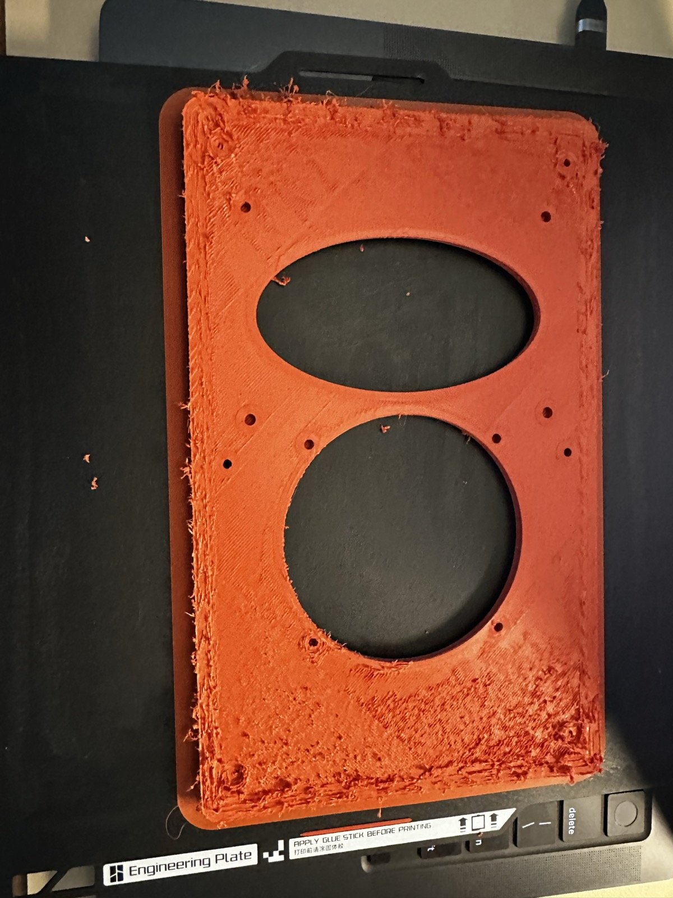
  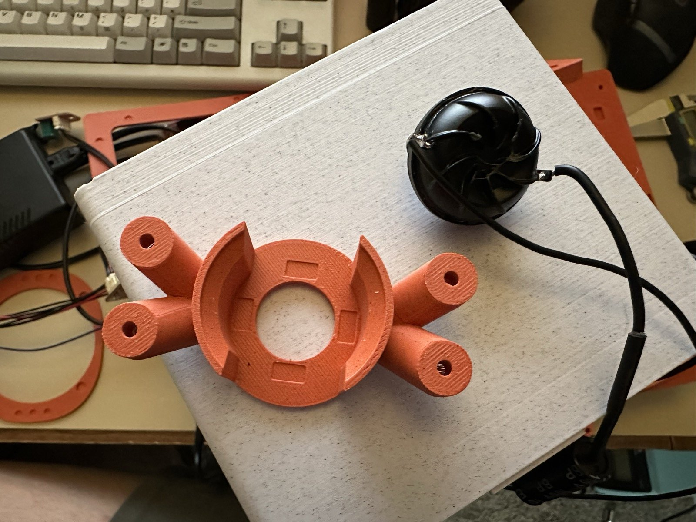

Left: a front baffle from the warping series. Right: an earlier tweeter retainer and the OT19 tweeter.

## Build one

Everything you print is in [`cad/`](cad/). Start with [`cad/PRINT_GUIDE.md`](cad/PRINT_GUIDE.md).

- **Printer settings I use:** Bambu Lab X2D, 0.4 mm nozzle, "0.20mm Standard" process,
  3 walls, 30% infill, no brim, supports off. Keep 0.20 mm layers; the built-in support tips
  depend on them.
- **Plates:** five STLs in `cad/plates/`, plus Bambu Studio projects in `cad/bambu/` with the
  magnet pauses already set (plate 1 pauses before layer 44, plate 2 before layer 17).
- **Hardware:** the drivers, radiators and amplifier listed above, M3 heat-set inserts
  (Ruthex RX-M3S×4) and M3 screws, eight 8 × 2 mm disc magnets, 1 × 8 mm foam tape,
  1/2 in acoustic foam, heat shrink and hot glue.
- **Desk stand (optional):** a tilt stand at 15°, 18° or 22° in `cad/stand/`.

These files are CAD and slicer checked. Fit, sealing and heat still need checking on a real
print, and I'd treat the newest front and rear parts as untested until I've printed them.

## Renders

The renders above come straight from the STLs in `cad/parts/`, placed with
[`tools/render/assemble.py`](tools/render/assemble.py) and lit in Blender with
[`tools/render/scene.py`](tools/render/scene.py). The woofer is Dayton Audio's reference model,
which isn't included here. There's no CAD for the tweeter or the passive radiators, so they are
simplified stand-ins built from the datasheet dimensions and my own measurements
([`ot19.py`](tools/render/ot19.py), [`ds115pr.py`](tools/render/ds115pr.py)), placed on the
seats the printed parts give them. They're for the pictures only.

| | |
|---|---|
| 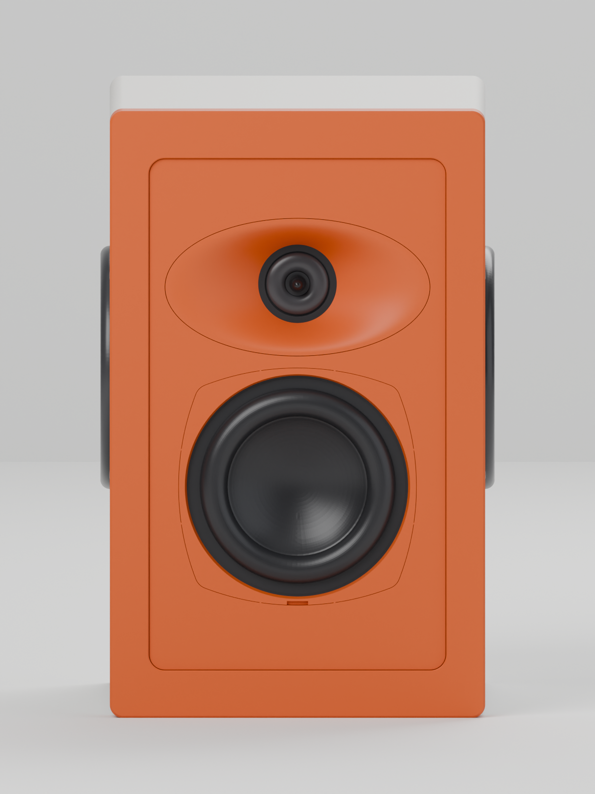 | 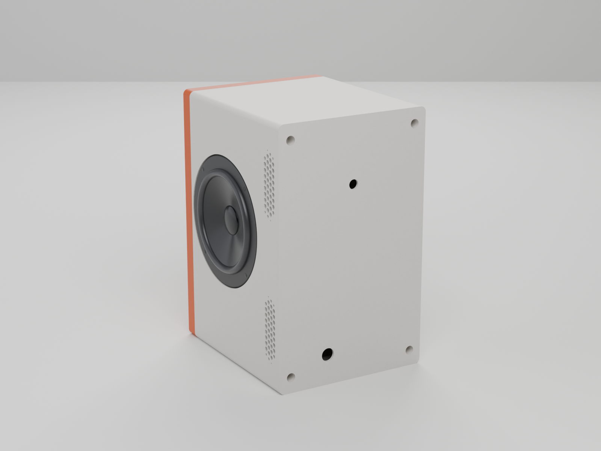 |
| 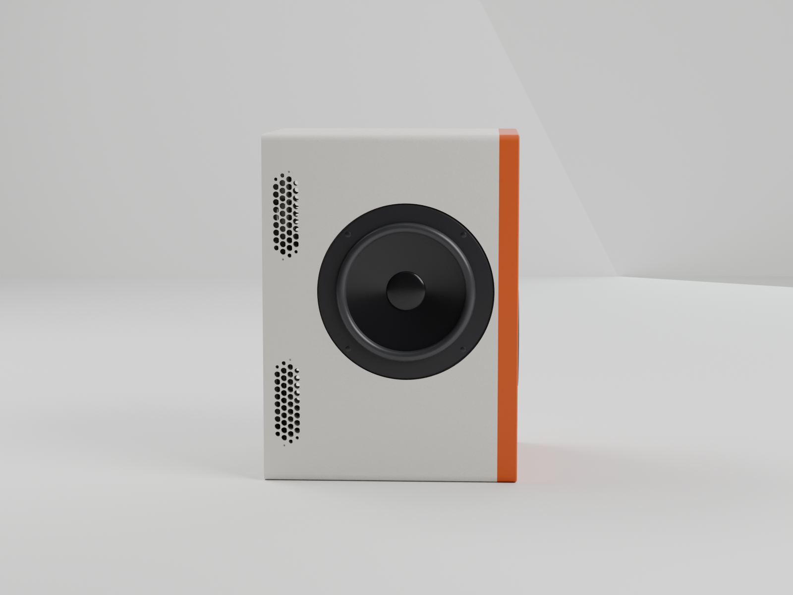 | |

## Repository layout

| Folder | What's in it |
|---|---|
| `cad/` | R4.35 print plates, individual parts, Bambu projects, tilt stand, gasket templates, print guide |
| `dsp/` | DSP settings and the last audited SigmaStudio EQ list |
| `measurements/` | Measurement data behind the plots |
| `simulation/` | Pre-build waveguide and system models |
| `docs/` | Design history, tuning log and images |
| `tools/render/` | Scripts that produced the renders |

## Tools

Python (trimesh, manifold3d, shapely, numpy, matplotlib) for parametric CAD and checks,
OpenSCAD for early versions, Bambu Studio, REW with a UMIK-1, SigmaStudio, and Blender for
the renders. I worked through most of this with AI coding assistants, which
wrote and ran a lot of the CAD and analysis code while I made the design calls, printed,
assembled, measured and listened.

## License

[CC BY-NC 4.0](LICENSE): build one for yourself, learn from it and share changes with credit, but don't sell it.
