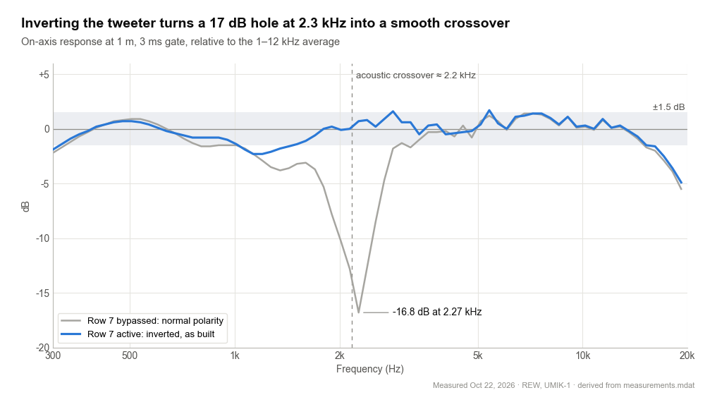
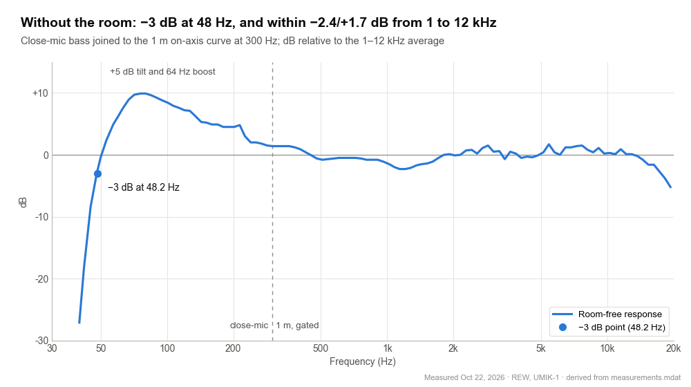
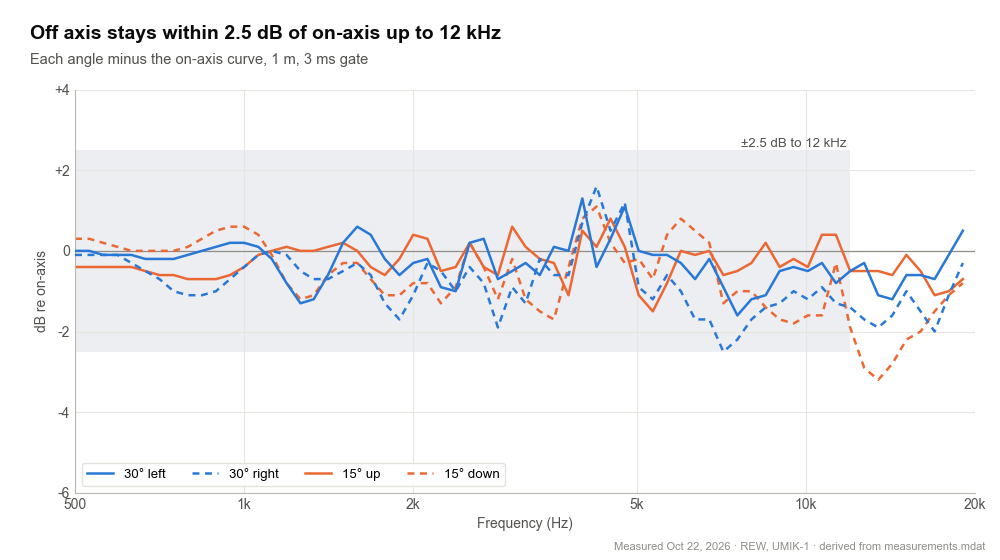
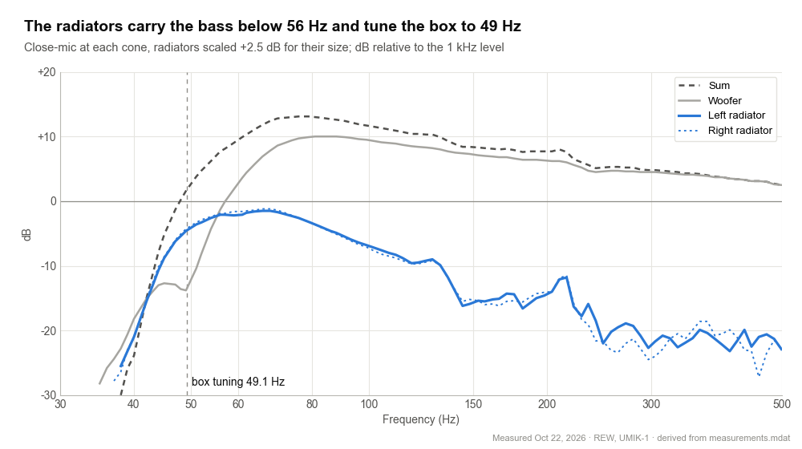
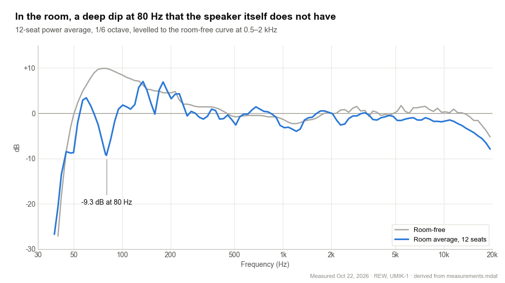
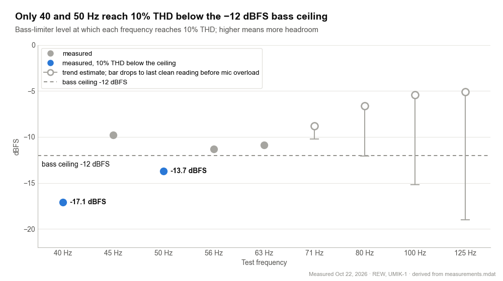
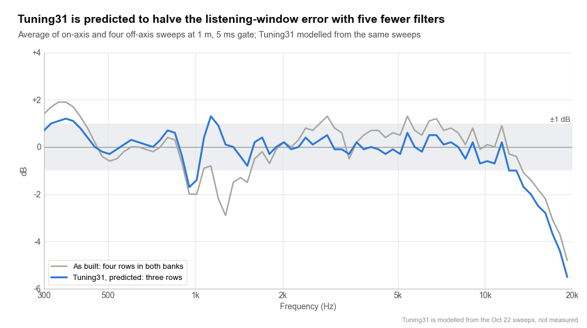

<!-- Charts are re-plotted from the data in derived/. Tuning31 is modelled, not measured. -->

# Pria 5 technical performance report

Oct 22, 2026 · Cameron Spears

## Summary

The Pria 5 is a compact active two-way speaker: a 3.5-inch woofer, a ring-radiator tweeter and two passive radiators, with all filtering and protection done by a Dayton KABD-250 DSP amplifier board. This report covers how it measures after tuning.

The Pria 5 measures within −2.4 to +1.7 dB of its mean from 1 to 12 kHz on axis, holds that to 30° off axis, and reaches 48 Hz (−3 dB) without the room. Its bass output is limited by the woofer, which reaches 10% THD at about −11 dBFS on the bass limiter at 56–63 Hz.

The final tuning, Tuning30, uses one fixed speaker preset, a +5 dB bass tilt, a −12 dBFS bass ceiling and a −1 dBFS clip guard. Full source volume is set to land at the clip guard, so 100% on the source is the speaker's clean maximum.

A refined EQ, Tuning31, is predicted to halve the remaining response error with 14 filters instead of 19; it has not been measured yet ([EQ refinement](#eq-refinement-tuning31-predicted)).

| Measure | Result |
| --- | --- |
| Bass extension, room-free | −3 dB at 48 Hz, −6 dB at 46 Hz, −10 dB at 45 Hz |
| On-axis flatness, 1–12 kHz (3 ms gate) | −2.4 to +1.7 dB about the mean |
| Crossover region, 1.5–4 kHz | −1.4 to +1.6 dB |
| Off-axis, ±30° horizontal and ±15° vertical | within 2.5 dB of on-axis up to 12 kHz |
| Passive radiator tuning | 49 Hz; left and right match within 0.3 dB |
| Bass limit, 10% THD at the bass limiter | −11 dBFS at 56–63 Hz; −14 dBFS at 50 Hz; −17 dBFS at 40 Hz |
| Bass ceiling | −12 dBFS peak, on the band below 150 Hz |
| Gain structure | mixers −6.5 dB: a full-scale source peaks at −1.4 to −1 dBFS, at the clip guard |

All measurements were taken on Oct 22, 2026, in one room, with one microphone; Method and limitations covers what that means for each figure.

## The system

The Pria 5 is an active two-way: a 3.5-inch woofer and a ring-radiator tweeter, each on its own amplifier channel, with two opposed passive radiators for the bass. A Dayton KABD-250 board does all the filtering, equalisation and limiting.

| Part | What it is |
| --- | --- |
| Woofer | Dayton ND91-4, on DAC1. Sd 30.4 cm², Xmax 4.6 mm, rated 30 W |
| Tweeter | Tymphany OT19NC00-04 with a 33 µF series capacitor, on DAC0 |
| Passive radiators | 2 × Dayton DS115-PR, opposed, one on each side, 8 g added to each. Sd 54.1 cm², Xmax 6 mm |
| Amplifier and DSP | Dayton KABD-250 (ADAU1701 DSP, 48 kHz) |
| Programming | KPX programmer, SigmaStudio 4.7 |

Driver figures are the manufacturer's and are the ones used for the excursion estimates below. The opposed radiators cancel each other's push on the cabinet, which needs equal mass on both: both carry 8 g. The 2026-10-21 study had assumed 11 g; the earlier measurements were in fact taken with 9 g and 8 g.

## Signal processing

The DSP sums the stereo input to mono, splits it into a woofer path and a tweeter path, and limits only the bass band. A final clip guard catches each driver on its own.

[Signal chain: Tuning30 final file · signal chain from input to amplifiers](derived/dsp_signal_chain.md)

The crossover is built from EQ rows: an 8th-order Linkwitz-Riley low-pass on the woofer and a 4th-order Bessel high-pass on the tweeter, giving an acoustic crossover near 2.2 kHz. The tweeter's 150 Hz phase match copies the woofer's bass split, so both paths keep the same phase. Bass Enhance only acts below −24 dB, so it does nothing at normal listening levels.

## Crossover and tweeter polarity

With the tweeter inverted, woofer and tweeter add smoothly through the crossover: 1.5–4 kHz stays within −1.4 to +1.6 dB. With normal polarity they cancel into a 17 dB hole at 2.3 kHz.

*measurements.mdat · two on-axis sweeps from one mic position, Oct 22, 2026*

Tweeter EQ row 7 sets the polarity: an IIR row with b0 = −1, which normal polarity simply bypasses. Both sweeps came from one mic position with nothing moved, so the difference is the polarity alone. Inverted matches the 2026-10-21 study's prediction and also sounded clearly better.

## Frequency response

Without the room, the response is −3 dB at 48 Hz and −10 dB at 45 Hz, and within −2.4 to +1.7 dB of its average from 1 to 12 kHz. The bass sits 8–10 dB above the midrange at 65–100 Hz, by design.

*measurements.mdat · close-mic woofer and radiators below 300 Hz, 1 m on-axis above (5 ms gate to 700 Hz, 3 ms above), from 40 Hz*

Most of the bass rise is the +5 dB tilt shelf and the +4.2 dB alignment boost at 64 Hz. Bass Enhance adds up to 4 dB more at quiet levels such as this −50 dBFS close-mic sweep, so the rise reads highest here. Below 48 Hz the two 50 Hz high-pass rows and the radiator roll-off cut the output steeply.

Above 1 kHz the largest deviations are −2.3 dB around 1.2 kHz, where the −4 dB row at 1220 Hz now cuts slightly more than needed, and +1.7 dB at 5.4 kHz. The treble falls to about −5 dB at 19 kHz.

## Directivity

Turned 30° left or right, or with the mic 15° above or below tweeter height, the response stays within −2.5 to +1.6 dB of on-axis up to 12 kHz. The tonal balance holds across a normal listening area.

*measurements.mdat · four off-axis sweeps at 1 m, each minus the on-axis sweep*

The largest drop is 30° right at 7 kHz, −2.5 dB. Vertically, 15° up stays within −1.5 to +0.8 dB and 15° down within −1.9 to +1.1 dB to 12 kHz, which is what the lower, steeper crossover was chosen for. Above 12 kHz the 15° down position falls to about −3 dB.

## Bass alignment

The passive radiators tune the box to 49 Hz, and the left and right radiators match within 0.3 dB.

*measurements.mdat · close-mic sweeps at −50 dBFS, 1/24-octave smoothing*

At 49 Hz the woofer barely moves, its close-mic level dipping to about −14 dB, while the radiators do the work. Below about 56 Hz they produce more than the woofer. The tuning was read where the radiator-to-woofer ratio peaks: 49.1 Hz, matching the 49.6 Hz predicted for 8 g per radiator; the study's original 52 Hz had assumed 11 g.

## In-room response

Averaged over 12 seats, the room cuts a deep dip at 80 Hz, about 12 dB below the in-room level at 60 and 100 Hz. Above about 300 Hz the in-room and room-free curves agree within a few dB.

*measurements.mdat · 12 sweeps around the listening seat at −30 dBFS, power-averaged*

The room-free curve has no dip at 80 Hz, so it comes from the room and the speaker's position: a wall or floor about 1.1 m away cancels right around 80 Hz. Moving the speaker shifts the dip; EQ cannot fill a cancellation, so it is deliberately left alone. The bass tilt is the placement control: less near walls or on a desk, more free-standing.

Above 5 kHz the room average sits 1–3 dB lower, as expected at seats that are farther away and off axis.

## Distortion and output limits

The woofer's distortion is mostly 2nd harmonic and grows smoothly with level. It reaches 10% THD at about −11 dBFS on the bass limiter at 56–63 Hz, higher above 70 Hz, and sooner below the radiator tuning. The bass ceiling sits at −12 dBFS.

*stepped thd2.mdat, converted with ReadBack readings at −30 dBFS · Oct 22, 2026*

At low drive (REW at −40 dBFS) THD was already 0.4–2.4% from 40 to 125 Hz, highest at 56–71 Hz. The 3% point came at only 0.5–1.7 mm of cone travel, a third or less of Xmax, so 3% marks this woofer's normal distortion rather than its limit. [Klippel defines Xmax](https://www.klippel.de/fileadmin/_migrated/content_uploads/AN_04_Peak_Displacement_Xmax.pdf) as the travel where distortion reaches 10%, and at 63 Hz the close-mic estimate puts 10% close to Xmax.

One flat ceiling has to cover every frequency. The strict rule, the lowest 10% point minus 1 dB, would give −18 dBFS, set entirely by 40 Hz, where the speaker is already 10 dB down; it would hold back the 56–125 Hz bass by 6–12 dB. At −12 dBFS, 56–125 Hz stay at or under about 9% THD, 50 Hz reaches about 12% and 40 Hz about 17%.

Every frequency stays just under the woofer's estimated Xmax at −12 dBFS, 40 Hz by about 1 dB. Below about 38 Hz the 50 Hz high-pass rows keep the woofer from reaching Xmax even at full input.

Above the bass limiter, the clip guard holds each driver at −1 dBFS peak. With both mixers at −6.5 dB, a full-scale 150 Hz–2 kHz sweep from the source at 100% peaks at −1.4 to −1 dBFS on the woofer channel, so full volume reaches the clip guard but rarely pushes into it.

## How it compares

Against two well-regarded small studio monitors, the Pria 5 reaches deeper bass from a similar-sized woofer and matches their flatness from 1 to 12 kHz. It gives ground in bass output, where small woofers run out first.

|  | Pria 5 | [Genelec 8010A](https://www.genelec.jp/documents/op-manual/active-monitors-subwoofers/8010A/8010a_datasheet.pdf) | [Neumann KH 80 DSP](https://www.fullcompass.com/prod/524996-neumann-kh80-kh-80) |
| --- | --- | --- | --- |
| Woofer | 3.5 in, plus two passive radiators | 3 in | 4 in |
| Bass extension | −6 dB at 46 Hz | −6 dB at 67 Hz | −6 dB at 53 Hz |
| Flatness | −2.4 to +1.7 dB, 1–12 kHz | ±2.5 dB, 74 Hz–20 kHz | ±2 dB, 59 Hz–20 kHz |
| Bass output | 10% THD at about −11 dBFS on the bass limiter, 56–63 Hz; SPL at 1 m not measured | 96 dB SPL peak | 92.1 dB SPL at 3% THD, 50–100 Hz, half space |

The monitors' figures are the manufacturers' anechoic specifications; the Pria 5's are gated in-room measurements of one unit, so treat this as a ballpark. The Pria 5 is also deliberately voiced with an 8–10 dB bass lift, which is why its flatness figure covers 1–12 kHz only.

## EQ refinement: Tuning31 (predicted)

A refined EQ, Tuning31, is predicted to halve the listening-window error, from 0.90 to 0.49 dB RMS, while cutting the filter count from 19 to 14. It has not been measured yet.

*measurements.mdat · five sweeps at 1 m; Tuning31 modelled, not yet measured*

Two findings drive it. The 1220 Hz notch (Q 5, −4 dB) was meant to cancel a narrow peak, but the close-mic woofer sweep, sharp enough to resolve it, shows at most a 1.5 dB bump there, so the notch dug a 4 dB hole. And the four speaker-EQ rows sat in both banks, although rows far from the crossover only act through one driver.

| Bank | As built (in both banks) | Tuning31 |
| --- | --- | --- |
| Woofer | 372 Hz, Q 0.44, +2.7 dB | 510 Hz, Q 0.56, +3.3 dB |
| Woofer | 1220 Hz, Q 5, −4.0 dB and 1577 Hz, Q 1.83, −2.4 dB | 1440 Hz, Q 1.5, −2.1 dB |
| Tweeter | 3444 Hz, Q 6, −2.7 dB | 3300 Hz, Q 3.5, −2.4 dB |

The worst listening-window dip shrinks from −3.0 to −1.9 dB, and on-axis error drops from 1.07 to 0.74 dB RMS. The crossover, bass alignment, bass tilt, limiter and gain settings are unchanged, so the measured bass limits still apply; 80–150 Hz comes out 0.3–0.6 dB lower.

Each change was applied to the measured impulse responses before gating. Rows moved into one bank were weighted by the electrical crossover, which is accurate far from 2.2 kHz; expect the prediction to hold within about 0.5 dB. A narrow dip at 1 kHz remains; it looks like a cabinet-edge or reflection effect, which EQ cannot fix cleanly.

## Method and limitations

Everything was measured with REW 5.31 and a miniDSP UMIK-1 (18 dB gain version) with its 0° calibration file, driving the KABD-250 over Bluetooth in exclusive mode.

| Measurement | Setup | Processing |
| --- | --- | --- |
| On- and off-axis | Mic at 1 m, midway between woofer and tweeter heights; log sweep at −15 dBFS; acoustic timing reference | Gated 1 ms before and 3 ms after the peak (half-Hann tapers); 1/12-octave smoothing |
| Close-mic bass | Mic about 3 mm from the woofer dust cap and 4–5 mm from each radiator; −50 dBFS | Radiators scaled by their diameter ratio (83/62 mm, +2.5 dB) and summed with the woofer; joined to the 5 ms-gated 1 m curve with a 250–400 Hz crossfade |
| Room average | 12 positions around the listening seat at ear height, about 0.5 m apart; −30 dBFS | Power average, 1/6-octave smoothing |
| Distortion | Stepped sine, THD vs level, 64k FFT, 2 averages, 1 dB steps from −40 dBFS; mic close to the woofer cap; one run per frequency, stopped at 3%, then repeated to 10% | REW level converted to bass-limiter level with one ReadBack reading per frequency at −30 dBFS |
| Cone travel | From the close-mic pressure | x = p / (ρ·ω²·a), a = effective cone radius |

Limitations:

- **Mic headroom.** The UMIK-1 overloads near 100 dB SPL at its normal input setting. Turning its input down helped, but its front end still saturates at about 119 dB SPL, so the 10% points from 71 to 125 Hz are extrapolated from the trend before that.
- **Close-mic level.** The close-mic sweeps ran at −50 dBFS, quiet enough for Bass Enhance1 to add its full +4 dB near 70 Hz. The room-free bass may read up to 4 dB high there, and about 1 dB high overall from the missing baffle loss.
- **Cone travel.** The estimates assume the mic distance above; 1 cm instead of 3 mm shifts them by 2–3 dB.
- **Not measured.** Maximum SPL at 1 m, far-field distortion, intermodulation and long-term power handling.
- **One unit, one room.** The in-room curve depends on placement; the speaker preset does not.

## Appendix: final DSP settings and files

Woofer EQ, in row order:

| Row | Type | Hz | Q | Gain dB | Purpose |
| --- | --- | --- | --- | --- | --- |
| 1–2 | High-pass × 2 | 50 | 1.0 | — | excursion protection |
| 3 | Peaking | 64.4 | 1.2 | +4.2 | bass alignment |
| 4 | Peaking | 372 | 0.44 | +2.7 | baffle step (both banks) |
| 5 | Peaking | 1220 | 5.0 | −4.0 | woofer and cabinet peak (both banks) |
| 6 | Peaking | 1577 | 1.83 | −2.4 | edge diffraction and woofer rise (both banks) |
| 7 | Peaking | 3444 | 6.0 | −2.7 | tweeter peak (both banks) |
| 8 | Low shelf | 100 | 0.71 | +5.0 | bass tilt |
| 9–12 | Low-pass × 4 | 2500 | 0.5412, 1.3066, 0.5412, 1.3066 | −4.0 on row 9 | LR48 crossover and woofer trim |

Tweeter EQ, in row order:

| Row | Type | Hz | Q | Gain dB | Purpose |
| --- | --- | --- | --- | --- | --- |
| 1–4 | Peaking | 372, 1220, 1577, 3444 | as woofer rows 4–7 | as woofer rows 4–7 | shared rows keep the crossover phase intact |
| 5 | High-pass | 2501 | 0.5219 | −10.5 | Bessel-24 crossover, first half, and tweeter trim |
| 6 | High-pass | 2231 | 0.8055 | — | Bessel-24 crossover, second half |
| 7 | IIR coefficients, b0 = −1 | — | — | — | tweeter polarity inversion (active) |

Files:

| File | What it is |
| --- | --- |
| `Tuning30_SpeakerPreset.dspproj` | speaker preset and bass tilt, original limiting, no pots |
| `Tuning30_Step1_ClipGuard.dspproj` | + clip guard |
| `Tuning30_Step2_BassCeiling.dspproj` | + new bass limiter at −9 dBFS, ReadBack on the limiter output |
| `Tuning30_Test_BassLimits.dspproj` | Step 2 with the bass limiter open, for the distortion runs |
| `Tuning30_Step3_Mixers.dspproj` | + −12 dBFS bass ceiling, mixers at −8 dB; the final tuning is this file with the mixers at −6.5 dB |
| `Tuning31_EQ.dspproj` | the final tuning with the refined EQ; predicted, not yet measured |
| `measurements.mdat` | 21 sweeps: polarity, on- and off-axis, close-mic bass, 12-point room average |
| `stepped thd.mdat` | stepped-sine runs to 3% THD, 40–125 Hz |
| `stepped thd2.mdat` | stepped-sine runs to 10% THD, 40–125 Hz |

## Terms used

| Term | Meaning |
| --- | --- |
| dBFS | Level relative to digital full scale; 0 dBFS is the largest signal the DSP can carry |
| THD | Total harmonic distortion: the harmonics a driver adds to a pure tone, as a percentage of that tone |
| Xmax | How far the cone can travel before distortion climbs steeply; Klippel defines it at 10% distortion |
| Passive radiator | An unpowered cone moved by the air inside the box; it extends the bass the way a port does |
| Close-mic (near-field) | Mic a few millimetres from a cone; the room is too quiet to matter there, so it shows the bass without the room |
| Gate | A short time window on a 1 m measurement that cuts off the room's reflections; 3–5 ms here |
| Listening window | The average of the on-axis and nearby off-axis responses: roughly what a seated listener hears directly |
| EQ row (biquad) | One second-order filter in the DSP: a boost, cut, shelf or crossover slope |
| LR48, Bessel-24 | The crossover slopes: 8th-order Linkwitz-Riley on the woofer, 4th-order Bessel on the tweeter |
| Bass limiter | Caps the level below 150 Hz so the woofer stays within its limits |
| Clip guard | A fast limiter at −1 dBFS on each driver that stops digital clipping |
| ReadBack | SigmaStudio's live level meter, used to read signal levels inside the DSP |

## Sources

- [Klippel, Application Note 04: Peak Displacement Xmax](https://www.klippel.de/fileadmin/_migrated/content_uploads/AN_04_Peak_Displacement_Xmax.pdf)
- [Genelec 8010A datasheet](https://www.genelec.jp/documents/op-manual/active-monitors-subwoofers/8010A/8010a_datasheet.pdf)
- [Neumann KH 80 DSP specifications, Full Compass](https://www.fullcompass.com/prod/524996-neumann-kh80-kh-80)
