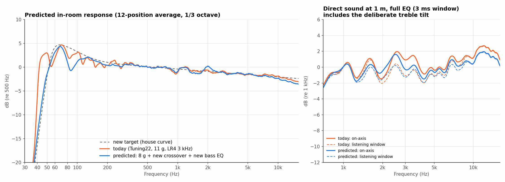
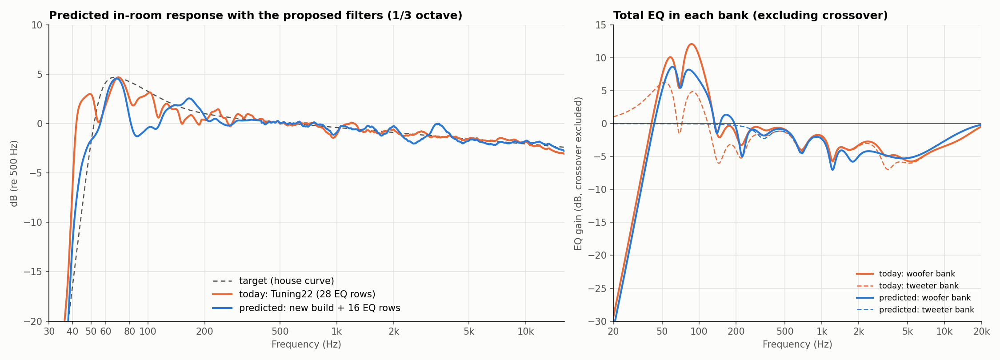
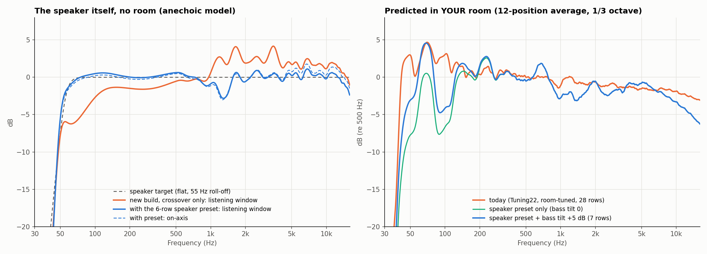

# Crossover, passive-radiator mass, bass-target and speaker-preset study (2026-10-21)

**Status:** this is the study as written on 2026-10-21, before anything was built. Its
predictions are model output. What was built from it (Tuning30), what was measured on
2026-10-22, and the prediction-against-measurement ledger are in
[`docs/tuning-status.md`](../../docs/tuning-status.md).

> **Corrections since this was written.** The study assumes 11 g of added mass on each passive
> radiator. On 2026-10-22 they turned out to carry 9 g and 8 g, so "today 11 g" below should
> read 9 g and 8 g. The mass recommendation (8 g each) was applied, and the radiators measured
> 49.1 Hz, against 49.6 Hz re-predicted for the real starting mass. The fitted radiator
> suspension is too stiff for the same reason. Refit it before reusing the bass model.
>
> **What's not in this repository.** The scripts read the September raw captures and Dayton's
> published ND91-4 polar files (`reference/ND91-4_*.frd`), which aren't included. So the
> scripts are here as a record of the method; they won't run from this repository alone.

**Basis:** measurements of the **September build**
(2026-09-29/30: driver set, delay trials, ±15° records, nearfields,
12-position room average).

The current R4.35 build keeps the same nominal acoustic cavity, driver
positions and lining templates. Its parts are newly printed, though, its
tweeter mounting changed (R4.32 leak fix), and its sealing may be better. Two
consequences:

* **Tweeter wiring polarity must be checked** before applying any "invert"
  setting below; see "Before implementing".
* **Sealing:** a perfectly sealed box changes the bass results by at most
  0.1 dB (`seal_sensitivity.py`).

No DSP project, hardware, CAD or release file was changed by this study.

## Recommendations

### Crossover

Asymmetric. The acoustic crossover moves from ~2.56 kHz to ~2.17 kHz.

| Setting | Today (Tuning22) | Recommended |
|---|---|---|
| Woofer low-pass | LR24 at 3 kHz | LR48 at 2.5 kHz: four 2nd-order low-pass rows at 2500 Hz, Q 0.541 / 1.307 / 0.541 / 1.307 |
| Tweeter high-pass | LR24 at 3 kHz | 4th-order Bessel, −3 dB at 3.55 kHz: high-pass rows 2501 Hz Q 0.522 and 2231 Hz Q 0.806 |
| Tweeter polarity | normal | **inverted, relative to the September wiring** |
| Tweeter delay | 3 samples | 3 samples |
| Trims | woofer −4, tweeter −10 dB | woofer −4, tweeter −10.5 dB |
| Corrective EQ near the crossover | several rows | keep the tweeter-only 3500 Hz / Q3 / −2 dB row; re-trim 1.2–3 kHz after a new room average |

Predicted, crossover only, 1/6-octave, 1–10 kHz, at 1 m on the midpoint axis
(curves in `predictions/crossover_3ms_1m_midpoint.csv`):

| Metric | Today | Recommended |
|---|---|---|
| On-axis deviation (RMS, peak-to-peak) | 1.42, 6.2 dB | 0.70, 3.9 dB |
| Listening window (0°, ±15° vertical, ±30° horizontal) | 1.24, 5.2 dB | 0.75, 3.5 dB |
| ±15° vertical lobing (RMS, worst dip) | 2.96, −6.1 dB | 1.78, −4.3 dB |
| Sine level at 1 m when the OT19 reaches 0.1 mm Xmax | 103.1 dB | 101.2 dB |

Tolerances and margins:

* It tolerates ±1 sample of delay, ±1 dB of trim and ±5% on either corner.
* Flipping the polarity back ruins it.
* If the tweeter ever sounds strained at full volume, raise both corners
  about 6%. That recovers about 1 dB of tweeter margin at almost no cost.

### Passive-radiator mass

Use **8 g added on each DS115-PR** (today 11 g), matched within about 0.2 g.
Keep the original washers.

* Tuning moves from 50.5 to about 53.8 Hz. 9 g is equally good in the worst
  case.
* To keep today's full, deep in-room bass instead, 9–12 g are equal and
  lighter is worse.
* The user chose clean volume over the deepest bass, which makes 8 g the
  pick.

### Bass target

The "punchy" target is in `Pria5_bass_target_house_curve.txt` (REW house-curve
format, 0 dB at 500 Hz). It is the −0.5 dB/oct line, a +4 dB low shelf at
**100 Hz**, and an 8th-order roll-off whose −3 dB point is 55 Hz.

| Hz | 40 | 45 | 50 | 55 | 60–80 | 100 | 150 | 200 | 500 | 1k | 10k |
|---|---|---|---|---|---|---|---|---|---|---|---|
| dB | −16.4 | −8.6 | −2.1 | +2.2 | +4.1 to +4.5 | +3.2 | +1.5 | +0.9 | 0 | −0.5 | −2.2 |

* Fill the ~85 Hz room dip by at most +8 dB of total EQ. Today it gets about
  +12 dB.
* Keep the roll-off steep (about 48 dB/oct). A 24 dB/oct roll-off at the same
  corner costs 3–10 dB of headroom.

Predicted against today, with 8 g, across all five bass fits:

* 50–100 Hz punch at the same volume within 0.3 dB;
* 120–250 Hz warmth +0.6 dB;
* **+2.4 to +3.2 dB more clean output**;
* 40–50 Hz down about 9.5 dB.

The shelf corner was first 150 Hz. That added +1.7 dB of 120–250 Hz warmth,
the opposite of the "subtly less warm" request behind Tuning22, so it was
moved to 100 Hz the same day.

The other options (punch within 0.5 dB and warmth within 0.75 dB of today):

| Option | Headroom | 40–50 Hz |
|---|---|---|
| +5 dB shelf at 85 Hz, 8 g | +2.4 dB | −8.7 dB |
| Deeper: +3 dB shelf at 100 Hz, 50 Hz roll-off, 9 g | +1.9 dB | −5 dB |
| DSP-only (keep 11 g), recommended target | +0.6 to +0.8 dB | −9.5 dB |

The final bass filters should be designed from a new room average against
this target. An automatic few-filter fit to the old average was rejected:
room modes made it lumpy.

### Predicted response after all three changes



Built by `full_prediction.py`. The base is the Tuning22 static prediction of
the 12-position room average. On top go:

* the 8 g PR change and a practical bass EQ to the target (cuts room peaks,
  never chases dips);
* the crossover change, as a power-weighted model ratio;
* a re-trim of existing rows: 1220 Hz −4 → −4.2, 1690 Hz −3 → −4.8,
  3300 Hz −2 → −1.9, tweeter 3500 Hz −2 → −1.7, 5200 Hz −4 → −2.9 dB.

Curves are in `predictions/inroom_full_range_1-3oct.csv`.

| In-room, vs target, 1/3 octave | Today (vs its own target) | Predicted (vs new target) |
|---|---|---|
| 180 Hz–16 kHz | −1.1 / +0.8 dB, RMS 0.32 | −1.2 / +1.1 dB, RMS 0.42 |
| 60 Hz–16 kHz | — | −4.7 / +1.1 dB, RMS 0.93; the low point is the ~85 Hz room dip, left partly unfilled on purpose |

Levels re 500 Hz, predicted (today in brackets):

| 45 Hz | 50 Hz | 55 Hz | 60 Hz | 70 Hz | 85 Hz | 100 Hz | 150 Hz | 1 kHz | 2 kHz | 5 kHz | 10 kHz |
|---|---|---|---|---|---|---|---|---|---|---|---|
| −6.5 (+2.4) | −1.4 (+3.0) | +1.3 (+0.1) | +3.2 (+2.0) | +4.2 (+4.7) | −0.6 (+1.9) | +1.1 (+3.1) | +1.4 (+0.1) | −0.9 (−1.1) | +0.2 (−0.6) | −1.4 (−1.5) | −2.3 (−1.9) |

The in-room average above ~200 Hz barely changes, because today's EQ already
forces it onto the target. The crossover's gains are elsewhere:

* the direct sound (right panel);
* consistency above and below the tweeter axis (±15° lobing −6.1 → −4.3 dB);
* fewer and smaller corrective filters.

### Predicted DSP settings (fewest filters)



`minimal_eq.py` and `predicted_dsp.py`; values in
`predictions/predicted_dsp_settings.csv`. These are starting values:

* the bass rows depend on the room and the speaker placement, so they must be
  re-derived from the next room average (and after the ~85 Hz placement test);
* the mid/treble rows are mostly speaker-related and should hold.

**Crossover** (or the crossover block, if it offers LR48 / Bessel-24): see
above. Polarity inverted relative to the September wiring, delay 3 samples,
trims −4 / −10.5 dB.

**Woofer bank, bass rows** (woofer only; their phase effect at the crossover
is negligible):

| Type | Hz | Q | dB | Why |
|---|---|---|---|---|
| High-pass | 52.6 | 0.90 | — | roll-off and protection (×2) |
| Peaking | 64 | 0.86 | +10.0 | the one broad bass lift (room + "feel" voicing) |
| Peaking | 70 | 6.0 | −5.2 | room peak |
| Peaking | 139 | 6.0 | −5.2 | room peak |
| Peaking | 224 | 6.0 | −6.1 | room peak |

**Both banks, identical** (keeps the crossover phase intact):

| Type | Hz | Q | dB | Why |
|---|---|---|---|---|
| Peaking | 335 | 2.85 | −2.0 | room / baffle region |
| Peaking | 682 | 3.69 | −3.9 | room / baffle region |
| Peaking | 1221 | 5.79 | −5.1 | woofer-band resonance (driver or cabinet) |
| Peaking | 1773 | 3.03 | −3.2 | woofer 1.1–1.8 kHz bump |
| Peaking | 4661 | 0.49 | −5.2 | one broad treble cut (in-room voicing) |

How it compares:

| | Today (Tuning22) | Predicted |
|---|---|---|
| Woofer / tweeter EQ rows | 15 / 13 | 11 / 5 (+4 / +2 crossover rows if not using the crossover block) |
| Unique corrective filters | 14 | 9 |
| Peak boost at 85–100 Hz | about +12 dB | +8 dB (capped) |
| In-room 180 Hz–16 kHz vs target (1/3 oct) | −1.1 / +0.8 dB, RMS 0.32 (fitted directly to measurement) | −1.0 / +1.3 dB, RMS 0.39 (model forecast) |
| Bass vs today | — | 60–80 Hz unchanged, 85–100 Hz −3.8 dB (dip not filled), 40–50 Hz −6.5 dB, 120–250 Hz +0.9 dB |
| Clean bass headroom vs today | — | +3.9 dB (all five fits; first limit ND91 near 83 Hz) |

Why the bass still needs a big lift (`bass_eq_breakdown.py`, relative to
300 Hz, 8 g, in-room):

| Hz | House curve asks | Speaker's own droop | Room | Full correction | Proposed EQ | Left vs target |
|---|---|---|---|---|---|---|
| 60 | +3.3 | −3.7 | −2.9 | +9.2 | +8.6 | −0.6 |
| 70 | +4.0 | −3.2 | −0.3 | +6.8 | +5.5 | −1.3 |
| 85 | +3.5 | −1.5 | −8.4 | +12.7 | +8.2 | −4.5 |
| 100 | +2.8 | −0.2 | −8.1 | +10.3 | +6.6 | −3.6 |

At 85 Hz the woofer itself is only 1.5 dB down. The room cancels 8.4 dB, and
the "feel" voicing asks for +3.5 dB. The ~+8 dB of EQ there is the tail of the
64 Hz lift, not a dedicated filter. It is capped so we don't spend excursion
fighting the cancellation.

What is gone and what remains:

* **Gone because of the build changes:** the crossover-region rows (common
  3300 Hz and tweeter-only 3500 Hz), the separate 58 Hz and 92 Hz bass
  boosts, and every bass row in the tweeter bank. The 5.2 kHz and 10 kHz rows
  merge into one broad cut.
* **The room** (the 70/139/224 Hz cuts, the 85–100 Hz dip, the size of the
  bass lift): changes with placement.
* **Voicing** (the bass lift, the broad treble cut): set by your house curve.
* **Two woofer-band features** (1.22 and 1.77 kHz) that no crossover can
  remove.

### Room-independent speaker preset (the recommended base, since 2026-10-21)

The user plans to build more of these speakers for different rooms: "I just
want to correct the speaker and not necessarily the room." So the DSP is
organised in three layers:

1. **Speaker preset, identical in every unit.** It makes the speaker itself
   flat across its listening window, from 60 Hz to 12 kHz, with a steep
   55 Hz bass roll-off. It includes baffle-step compensation and fixes the
   speaker's own peaks.
2. **Bass tilt.** One low shelf at 100 Hz (Q 0.71), 0 to +6 dB, set by
   placement and taste. Walls and desks add bass, so use less tilt near them.
   In the current room +5 dB matches today's 60–70 Hz "feel".
3. **Optional room cuts, per room, cuts only.** For the current room these
   would be about 70, 225 and 680 Hz. Never boost into dips.



*Prediction from the 2026-10-21 model. The preset built from it was measured as Tuning30 on 2026-10-22.*

**Speaker preset rows** (`predictions/speaker_preset.csv`; plus crossover D1
and 8 g PRs):

| Bank | Type | Hz | Q | dB | Fixes |
|---|---|---|---|---|---|
| Woofer | High-pass ×2 | 50 | 1.0 | — | protection; with the PRs gives the 55 Hz roll-off |
| Woofer | Peaking | 64 | 1.2 | +4.2 | bass alignment |
| Both | Peaking | 372 | 0.44 | +2.7 | baffle step (simulated with BEM) |
| Both | Peaking | 1220 | 5.0 | −4.0 | narrow woofer/cabinet peak, at every mic position |
| Both | Peaking | 1577 | 1.83 | −2.4 | cabinet-edge diffraction peak and woofer rise |
| Both | Peaking | 3444 | 6.0 | −2.7 | tweeter peak |

Predicted room-free result: listening window within −1.0/+1.2 dB from 60 Hz to
12 kHz (RMS 0.41), on-axis RMS 0.61 dB. That is 7 woofer rows and 4 tweeter
rows, against today's 15 and 13.

**In the current room** (12-position average), relative to today's
room-tuned Tuning22:

| Bass tilt | 60–70 Hz | 85–100 Hz | 45–50 Hz | 1 kHz | 10 / 15 kHz | Clean bass headroom at equal midrange |
|---|---|---|---|---|---|---|
| 0 | −4 to −5 dB | −9 to −10 dB | −11 dB | −1.7 dB | −1.4 / −2.9 dB | +9.3 dB |
| +5 dB | about 0 | −6 to −7 dB | −6 to −7 dB | −1.7 dB | −1.4 / −2.9 dB | +5.3 dB |

**How it was built:**

* `speaker_anechoic.py`: the room-free full-range model.
  * The bass model gives the woofer and PR outputs.
  * The woofer is shaped by the BEM baffle step (`bem_woofer/`).
  * Above 850 Hz it uses the measured 3 ms driver data. Overlap check: model
    and measured woofer agree within ~1 dB from 400 Hz to 1 kHz.
* **Tweeter directivity above 4 kHz.** The waveguide FEM was replaced by the
  measured ±30° horizontal data, scaled with angle. The FEM overstated
  off-axis high treble: +1 dB at 30° and 10 kHz, against −2.5 dB measured.
* **Fitting.** `speaker_preset.py` fits the preset with the high-pass held at
  ≥ 50 Hz and the bass lift at ≥ 55 Hz. An unconstrained fit put the
  high-pass at 35 Hz or boosted 40 Hz, both unsafe for excursion.
* **Speaker or room?** `speaker_vs_room_peaks.py` tests each narrow feature
  across all mic positions. ~1.2 kHz is the speaker (1.14–1.31 kHz everywhere);
  ~680 Hz is the room (603–766 Hz); the ~85 Hz dip is the room.

**Limits:**

* **Vertical treble is unresolved.** At 10–14 kHz, ±15° measured ≈ 0 to −3 dB
  on 2026-09-29 but about −9 dB on 2026-09-30. The FEM was kept for vertical;
  re-measure.
* **The 85 Hz dip is left alone** by design (room).
* **Treble in this room** comes out 1.5–3 dB lower than today at 10–15 kHz.
  This is the natural in-room fall of a flat speaker. If it is missed, a small
  high shelf is a taste setting, not a correction.

## Key findings

* **Bass limit.** Today's first bass limit is ND91 excursion near 86 Hz. The
  Tuning22 EQ adds +10 to +12 dB there to fill an in-room hole about 7 dB
  deeper than the speaker's own response, likely a floor or wall null.
  Speaker placement could be worth more than any PR or EQ change.
* **Tweeter.** The OT19 with its 33 µF capacitor and the waveguide measures
  flat ±1 dB from 1.1 to 14 kHz, apart from a +3 dB rise at 3.5 kHz. How low
  the crossover can go is set by the OT19's 0.1 mm Xmax, not by its response.
* **Woofer and PRs in the box.** The fitted woofer Qts is ≈ 0.8 (datasheet
  0.41). The PR suspensions are ~2.5× stiffer than the datasheet, with a
  smaller effective area. September Fb was 50.4 Hz, with a tight box
  (fitted leakage QL ≈ 37).
* **Vertical lobing.** The measured ±15° lobing behaves like ~2× the ideal
  geometric path difference (k ≈ 1.95). Treble is 6–9 dB down at 10–11 kHz at
  ±15° vertical, so keep the tweeter near ear height.

## Before implementing (current build)

1. **Polarity check.** Take one on-axis sweep at 1 m on the midpoint height
   with the current preset, and view it with a ~3 ms window.
   * Same wiring as September: 1.5–4 kHz stays within about ±2 dB of
     `predictions/polarity_check_today_preset.csv` (`fig4_polarity_check.png`).
   * Reversed tweeter: a ~17 dB notch near 2.6 kHz. Every "invert" here then
     flips.
2. **Better still: re-capture the driver set on the current build.** Take
   woofer-only, tweeter-only and combined sweeps, two each, from one mic
   position, using the split measurement project as on 2026-09-30.
   * Import them with `import_driver_set.py` (tested: it reproduces the
     September files bit-for-bit).
   * Re-run the study with `PRIA_DRIVER_SET=<folder>`. Polarity and any
     build differences are then built in.

## Alternatives considered and rejected

| Alternative | Why rejected |
|---|---|
| LR2 crossovers | Smoothest response but tweeter excursion: Xmax reached at about 90–95 dB near 1 kHz |
| Symmetric LR4 at about 2.4 kHz | Good, but worse than the asymmetric design (score 1.16 vs 0.94) |
| A ~4 kHz acoustic crossover | Scores well only with k = 2; collapses with pure geometry (vertical RMS 4.8 dB) |
| Lighter PRs (0–6 g) | Large headroom loss below the new tuning, for any target that keeps bass to 50–55 Hz |
| 4th-order bass roll-off | Costs 3–10 dB of headroom (woofer at 36–40 Hz) |
| Automatic bass-EQ fit to the old room average | 1.3–3.2 dB misfit; room modes make the target too lumpy |
| Free per-driver off-axis fit (`fit_vertical.py`) | Ill-conditioned; JSON kept for the record, not used |

## Method

1. **Crossover model** (`drivers.py`, `xover_model.py`).
   * Time-referenced woofer and tweeter captures (`Crossover_check2_corrected`,
     both repeats, 3 ms window).
   * The audited DSP chain at capture is divided out to get raw drivers, then
     candidate filters are applied.
   * Tweeter below 1.1 kHz: OT19 T/S model through the 33 µF capacitor
     (matches the measurement within ~1.5 dB from 1.1 to 4 kHz).
   * Woofer above 11 kHz: ND91 manufacturer shape.
   * Validated on the Tuning01/02/03 delay trials: median error ≈ 0 dB
     (`validate_offaxis.py`, `fig3_model_validation.png`).
   * The DSP's tweeter delay also delays REW's acoustic reference;
     comparisons account for this.
2. **Off-axis model** (`geometry.py`).
   * Measured on-axis data, real driver positions, ND91 manufacturer
     directivity and waveguide FEM directivity.
   * The vertical path factor k is fitted to the five ±15° records at three
     delays (`fit_effective_spacing.py`, `validate_deltas.py`).
3. **Search** (`search_symmetric.py`, `optimize_xover.py`, `standard_asym.py`).
   * Score = 0.35 on-axis + 0.45 listening window + 0.20 ±15° lobing (1–10 kHz).
   * Constraint: OT19 Xmax not reached below about 100 dB sine at 1 m.
   * The excursion calculation ignores waveguide gain, so it is conservative.
4. **Robustness** (`robustness.py`, `design_b_checks.py`, `final_design.py`).
   3, 5 and 8 ms windows; k = 1, 2 and 2.5; delay, trim, corner and polarity
   tolerance.
5. **Bass model** (`lf_model.py`, `fit_lf.py`, `lf_ensemble.py`).
   * Lumped ND91 + 2 × DS115-PR + box.
   * Fitted in magnitude and phase to the woofer and both PR nearfields of
     2026-09-29: ~0.5 dB and ~5° error.
   * Box volume can't be separated from PR area, so five fits pin
     Vb = 2.3 / 2.5 / 2.7 / 2.9 L or leave it free. Conclusions must hold
     across all five.
6. **In room** (`inroom_pr_study.py`, `volume_first.py`, `bass_options.py`,
   `bass_target_study.py`, `seal_sensitivity.py`).
   * The Tuning12 12-position average is scaled by the model ratio (mass m ÷
     11 g). Room transfer below 300 Hz is mass-independent.
   * The woofer EQ is re-solved for each target.
   * Headroom: the sine level, 35–200 Hz, at which the ND91 (4.6 mm), a PR
     (6 mm) or the amplifier (12 V rms) first reaches its limit.

## Files

| File | Purpose |
|---|---|
| `common.py` | Filters (RBJ/Butterworth at 48 kHz, as in all earlier audits), smoothing, data loading (`PRIA_DRIVER_SET`) |
| `drivers.py`, `geometry.py`, `xover_model.py` | Crossover and off-axis model |
| `lf_model.py`, `fit_lf.py`, `lf_ensemble.py` | Bass model and fits |
| `import_driver_set.py` | New REW driver-set capture → study input (needs `javaobj-py3==0.6.1`) |
| `polarity_check.py`, `export_predictions.py` | Reference curves for the next measurements (`predictions/`) |
| `make_figures.py` | `fig1_crossover.png`, `fig2_pr_mass.png`, `fig3_model_validation.png` |
| `full_prediction.py` | `fig5_predicted_response.png` and the full-range in-room prediction (ideal EQ) |
| `speaker_anechoic.py`, `speaker_preset.py`, `speaker_preset_inroom.py`, `make_fig7.py` | Room-free model, speaker preset fit, in-room check, `fig7` |
| `bem_woofer/` | BEM baffle step of the real cabinet (own README) |
| `speaker_vs_room_peaks.py`, `measured_hf_directivity.json` | Speaker vs room test; measured ±15°/±30° high-frequency directivity |
| `minimal_eq.py`, `predicted_dsp.py` | Fewest-filter EQ fits; `fig6_predicted_dsp.png`; `predictions/predicted_dsp_settings.*` |
| `room_dip_evidence.py` | Dip frequency/depth at every retained mic position |
| `bass_target_study.py` | Bass-target search; writes `Pria5_bass_target_house_curve.txt` |
| `reference/` | ND91-4 manufacturer FRDs and the waveguide FEM directivity used by the model |
| `*.json`, `symmetric_search.csv` | Saved results of each script |

## Reproduce

Needs Python 3 with numpy, scipy and matplotlib. Run from this folder, in this
order:

```sh
python3 search_symmetric.py
python3 optimize_xover.py        # ~25 min
python3 standard_asym.py 100
python3 robustness.py
python3 design_b_checks.py
python3 final_design.py
python3 fit_lf.py
python3 lf_ensemble.py
python3 inroom_pr_study.py
python3 volume_first.py
python3 bass_options.py
python3 bass_target_study.py
python3 seal_sensitivity.py
python3 polarity_check.py
python3 export_predictions.py
python3 make_figures.py
python3 full_prediction.py
python3 predicted_dsp.py
python3 room_dip_evidence.py
python3 speaker_vs_room_peaks.py
# bem_woofer/run_bem_woofer.py needs the BEM environment (see bem_woofer/README.md)
python3 speaker_preset_inroom.py
python3 make_fig7.py
```

To use a new capture, prefix any command with `PRIA_DRIVER_SET=<folder made by
import_driver_set.py>`.

## Limits

* **Measured build.** All inputs come from the September build; see Basis
  above.
* **Lining.** The nearfields predate the internal lining, which shifts tuning
  slightly. The mass ratio still holds: Fb ∝ 1/√(total moving mass), ≈ 24.8 g
  at 11 g added.
* **No impedance data.** Woofer parameters are effective in-box values.
* **Headroom.** Figures are linear sine excursion limits, not distortion
  measurements.
* **Vertical positions.** The ±15° mic positions were approximate, so k is an
  effective factor.

## Change log

* **2026-10-21:** the initial crossover and PR study; a volume-first re-run
  after the user preferred volume over deep bass; the bass target ("as long as
  I can feel the bass"); a sealing sensitivity check and the polarity check
  after the user noted the current build may seal better and have different
  tweeter polarity; the driver-set importer; the full-range predicted
  response (`fig5`). That last step exposed added 120–250 Hz warmth from the
  150 Hz shelf corner, which was moved to 100 Hz. Diagnosed the ~85 Hz dip as
  room/placement. Predicted a fewest-filter DSP list (`fig6`). Fits that used
  a resonant high-pass, boost/cut pairs or narrow boosts into room dips were
  rejected in favour of a high-pass pair, one broad lift and cuts only.
  The user then chose to correct the speaker, not the room, so the
  room-independent speaker preset (`fig7`) became the base. The room-tuned sets
  (D3/D5) remain as references for an optional room layer. Added: the BEM
  baffle step, the measured high-frequency directivity, and the speaker-vs-room
  peak test.
